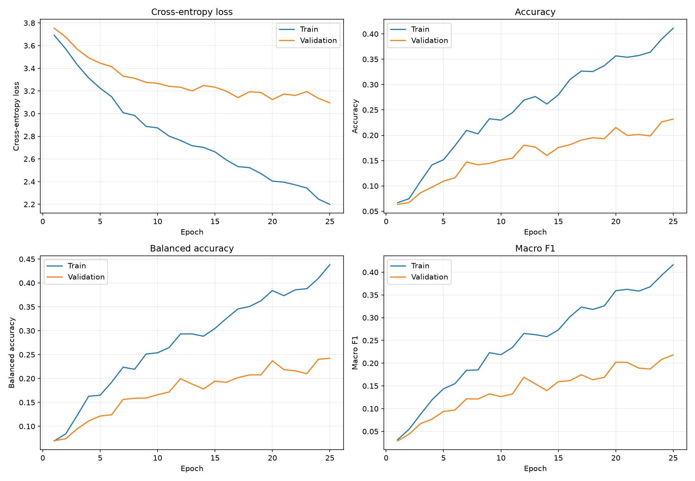
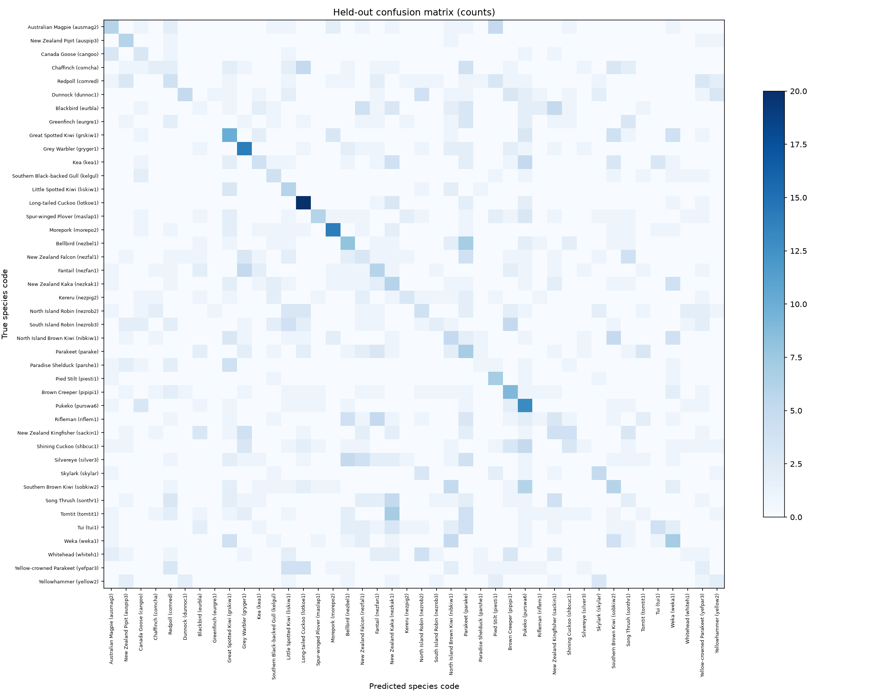
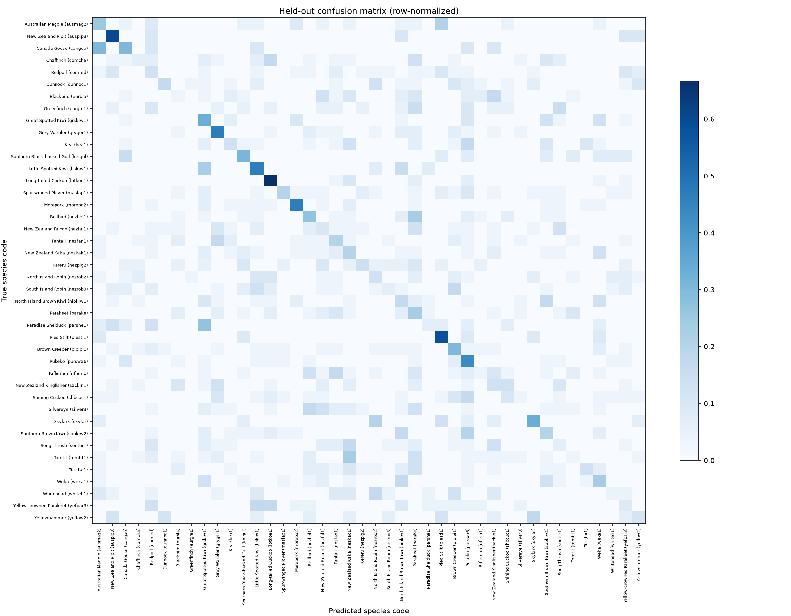

# Olly Powell bird CNN: results

This report belongs to Kaggle's
[`ollypowell/new-zealand-bird-sound`](https://www.kaggle.com/datasets/ollypowell/new-zealand-bird-sound),
not the CACOPHONY dataset. The full artifacts are saved under
[`olly_training_outputs/`](./olly_training_outputs/).

## Dataset EDA

The current inventory reports 271,365 readable mono FLAC clips across 133
primary-label codes and 57,874 inferred source recordings. Clip duration is
typically short (median five seconds); source clip names include numbered
segments, so grouped source IDs are used for splitting. The largest class has
50,010 clips, a 50,010-to-1 raw imbalance against the rarest labels.

The dataset includes a `weta` label mapped to Tree Weta, which is an insect.
This class is not included in the bird CNN. The training defaults require at
least 100 clips and 50 inferred source recordings per species, then cap the
sample at 150 clips per species and one clip per species/source recording. That
results in 42 bird classes for this run.

## Held-out evaluation

The test set contains 1,087 clips from 948 inferred source recordings. All
selected clips from a source recording are kept within one split.

| Metric | Held-out result |
|---|---:|
| Accuracy | 19.8% |
| Balanced accuracy | 21.4% |
| Macro precision | 20.4% |
| Macro recall | 21.4% |
| Macro F1 | 18.8% |
| Weighted F1 | 18.4% |
| Top-3 accuracy | 36.3% |
| Cross-entropy loss | 3.300 |
| Log loss | 3.296 |
| Matthews correlation | 0.180 |
| Cohen's kappa | 0.179 |
| Majority-class accuracy baseline | 2.8% |
| Uniform-guess balanced-accuracy reference | 2.4% |

These are baseline results on one grouped split. Accuracy is above the
majority-class reference, but macro F1 remains low; the model still confuses
many species. Per-class scores and support are important context, and these
metrics do not establish generalization to new recordists, locations, or
collection conditions.

## Eight-species experiment using all available recordings

The eight labels in [`class_list.csv`](./class_list.csv) were also trained
with no per-species recording cap. This selected 76,946 clips from 47,520
inferred source groups. The held-out test split contains 15,389 clips from
9,515 source groups; train and validation contain 46,167 and 15,390 clips.
This run used CUDA on an NVIDIA GeForce GTX 1070 and completed 24 epochs
before early stopping; the best-validation-loss checkpoint was from epoch 18.
No selected audio files failed to decode.

| Metric | Held-out result |
|---|---:|
| Accuracy | 69.3% |
| Balanced accuracy | 59.9% |
| Macro precision | 57.9% |
| Macro recall | 59.9% |
| Macro F1 | 57.8% |
| Weighted F1 | 68.7% |
| Top-3 accuracy | 90.7% |
| Cross-entropy loss | 0.924 |
| Majority-class accuracy reference | 39.6% |
| Uniform-guess balanced-accuracy reference | 12.5% |

This is a promising improvement for the eight-species scope, but it is not a
controlled comparison to the 500-per-species run: the latter used an equal
class sample and a different grouped test split. The all-recordings test
distribution is imbalanced, so balanced accuracy and macro F1 should be
considered along with top-1 accuracy. The details and limitations are in
[`OLLY_CNN_TRAINING_NOTES.md`](./OLLY_CNN_TRAINING_NOTES.md).

## Plots

### Original 42-class run: training and validation metrics

### Eight-class all-recordings run: training and validation metrics

### Original 42-class run: confusion matrix (raw counts)

### Eight-class all-recordings run: confusion matrix (raw counts)

### Original 42-class run: confusion matrix (row-normalized)

### Eight-class all-recordings run: confusion matrix (row-normalized)

## Output files

- [`best_model.pt`](./olly_training_outputs/best_model.pt) — CNN checkpoint
  and class-name mapping.
- [`metrics.json`](./olly_training_outputs/metrics.json) — full test metrics,
  split counts, baseline values, and per-class report.
- [`per_class_metrics.csv`](./olly_training_outputs/per_class_metrics.csv) —
  per-species precision, recall, F1, and test support.
- [`training_history.csv`](./olly_training_outputs/training_history.csv) and
  [`training_metric_curves.png`](./olly_training_outputs/training_metric_curves.png)
  — per-epoch train/validation measures and plots.
- [`test_confusion_matrix_counts.csv`](./olly_training_outputs/test_confusion_matrix_counts.csv)
  and
  [`test_confusion_matrix_normalized.csv`](./olly_training_outputs/test_confusion_matrix_normalized.csv)
  — numeric confusion matrix files.
- [`decode_errors.csv`](./olly_training_outputs/decode_errors.csv) — files
  skipped because of decoding errors; none occurred in this run.

The eight-species all-recordings checkpoint, metrics, per-class results, and
plots are in [`class_list_all_data_outputs/`](./class_list_all_data_outputs/).
The temporary spectrogram cache was removed after training.

EDA tables and charts are in [`dataset_report/`](./dataset_report/). The
training decisions, label filter, and evaluation limitations are described in
[`OLLY_CNN_TRAINING_NOTES.md`](./OLLY_CNN_TRAINING_NOTES.md).
