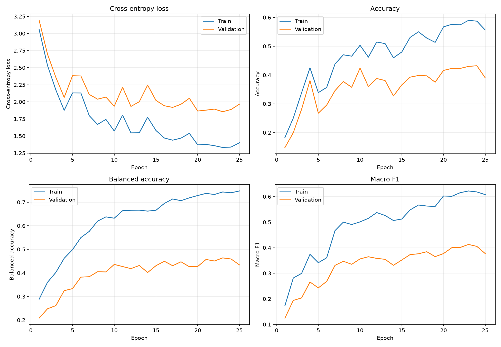
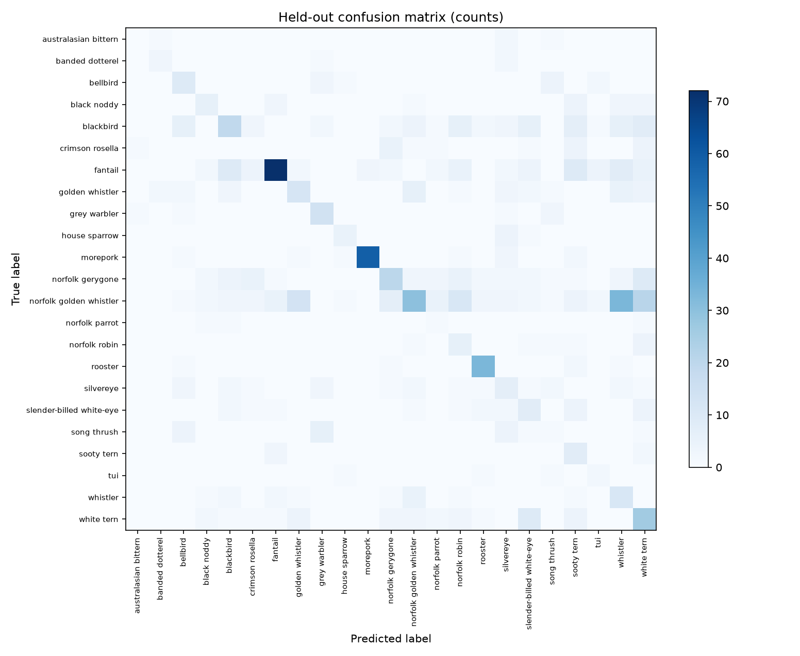
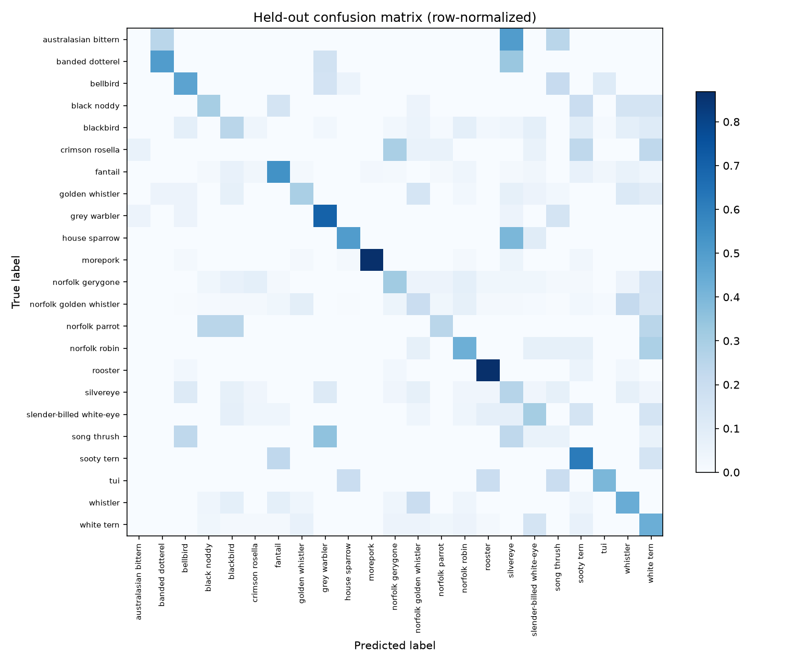

# Bird CNN training results

The full training outputs are saved in [`training_outputs/`](./training_outputs/),
inside this project so they are easy to open in VS Code. The original copies
remain in `E:\CACOPHONY\cnn_output`.

## Held-out test results

The test set contains 856 annotated segments from 240 recordings. Recordings
were kept in a single split to avoid putting clips from the same recording in
both training and evaluation.

| Metric | Result |
|---|---:|
| Accuracy | 41.1% |
| Balanced accuracy | 39.1% |
| Macro precision | 34.6% |
| Macro recall | 39.1% |
| Macro F1 | 34.3% |
| Weighted F1 | 42.5% |
| Top-3 accuracy | 67.4% |
| Cross-entropy / log loss | 1.909 |
| Matthews correlation | 0.376 |
| Cohen's kappa | 0.371 |
| Majority-class accuracy baseline | 17.5% |

These are baseline results for this grouped split, not a guarantee of
performance on new locations, recorders, or species. The per-class CSV includes
test support because scores for rare classes have greater uncertainty.

## Plots

### Training and validation curves

### Confusion matrix (counts)

### Confusion matrix (row-normalized)

## Files

- [`best_model.pt`](./training_outputs/best_model.pt) — CNN checkpoint and class
  names.
- [`metrics.json`](./training_outputs/metrics.json) — full test metrics,
  per-class report, split sizes, and baselines.
- [`per_class_metrics.csv`](./training_outputs/per_class_metrics.csv) — class
  precision, recall, F1, and support.
- [`training_history.csv`](./training_outputs/training_history.csv) — metrics
  for each training epoch.
- [`test_confusion_matrix_counts.csv`](./training_outputs/test_confusion_matrix_counts.csv)
  and
  [`test_confusion_matrix_normalized.csv`](./training_outputs/test_confusion_matrix_normalized.csv)
  — numeric confusion matrix values.
- [`decode_errors.csv`](./training_outputs/decode_errors.csv) — two files that
  could not be decoded during training.

For details on the CNN, data preprocessing, split design, and the meaning of
these measures, see [`CNN_TRAINING_NOTES.md`](./CNN_TRAINING_NOTES.md).
